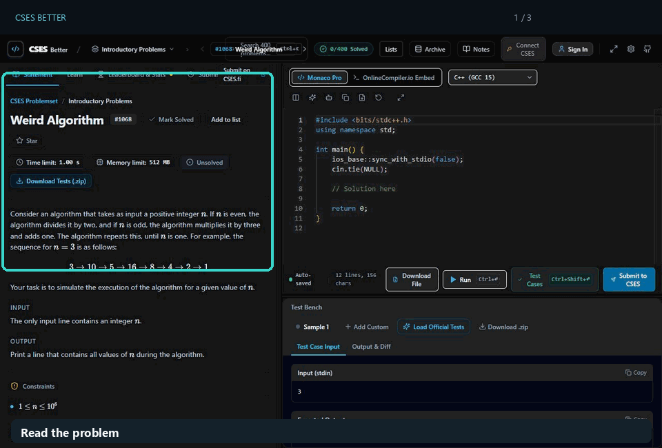

# CSES Better

Practice CSES problems in a focused browser workspace with an editor, test runner, notes, and progress tracking.

<p>
  <a href="https://cses-better.vercel.app"></a>
  <a href="https://github.com/codewithpom/cses-better/stargazers"></a>
  <a href="LICENSE"></a>
</p>


[Open the live app](https://cses-better.vercel.app) · [Go to practice](https://cses-better.vercel.app/practice) · [Contribute](CONTRIBUTING.md)

[](public/workspace.jpg)

## What you can do

- Read problem statements, edit solutions in Monaco, run selected inputs, and check loaded test cases.
- Connect a personal CSES account to submit solutions and inspect official verdicts and available judge results.
- Track work with problem lists, stars, notes, and verified solve streaks.
- Browse Learn explanations and visual lessons, plus a separate olympiad problem bank.
- Use optional AI prompt links and choose whether editor code is included.
- Practice as a guest or sign in for supported cloud synchronization.

Local workbench results only describe the inputs available to the app; official acceptance comes from CSES. Compiler and CSES account features depend on those external services and their availability.

## Run locally

Requirements: Node.js 22 and npm.

```sh
git clone https://github.com/codewithpom/cses-better.git
cd cses-better
npm ci
cp .env.example .env.local
npm run dev
```

Open [http://localhost:3000](http://localhost:3000) or [http://localhost:3000/practice](http://localhost:3000/practice).

Configure your own compiler credentials for execution. The embedded compiler may need its own widget key. Supabase enables cloud features; without it, guest mode remains available. For app sign-in, configure GitHub OAuth and allow the deployment's `/auth/callback` URL. Optional server-side CSES credentials enable shared-session features; a personal CSES connection is separate from app sign-in.

Never commit `.env.local`. Rotate previously committed working bot credentials before public release. See [SECURITY.md](SECURITY.md).

## Checks and deployment

```sh
npx tsc --noEmit
npm test
npm run build
```

Pull request CI runs these checks. Verify OAuth, compiler access, and official submissions separately with a maintainer-controlled account. Set `NEXT_PUBLIC_APP_URL` to the deployment origin, and review the preview on phone, tablet, and laptop before promotion.

Guest work is stored in the browser. Export a JSON backup through settings before clearing site data. Cloud sync covers supported records; check each feature's status and retry failures. Keep backups for local-only work.

## Data, accounts, and workspace details

### Lists, Learn, and cloud synchronization

Lists are saved locally and included in JSON backups. Signing in imports guest lists once and synchronizes account lists separately. Changes remain available offline; use **Retry sync** in Lists if a sync fails. If two devices edit the same list, the cloud version is kept and the local version is saved as a recovered list. Deleted lists use tombstones so an older device cannot restore them accidentally. Learn lessons are bundled static files; hints and explanations are revealed on demand.

Before enabling cloud list synchronization, deploy [`20261104172357_user_problem_lists.sql`](supabase/migrations/20261104172357_user_problem_lists.sql) to the linked Supabase project with `supabase db push`. It restricts authenticated users to their own rows and enforces revision increments. Local lists continue to work if the migration is not deployed.

### AI help, submissions, and streaks

**Ask AI** opens a hint-first prompt in Grok, or lets you copy it and open ChatGPT, Claude, or Gemini. **Open Claude Desktop** is an optional link for the installed app. Editor code is included only when selected. Grok may ask for confirmation before sending. If clipboard access fails, the menu provides selectable prompt text.

Submission filters query CSES history. Leaderboard **See code** retrieves accepted source; incomplete searches are labeled as the fastest result found. Official verdicts and available test details appear separately from local workbench runs. An interrupted verdict check can be retried without resubmitting code.

Stars are stored per app account, with offline changes retried during synchronization. The streak indicator counts verified personal CSES accepts, using the earliest retrieved acceptance per problem and a persisted timezone. Use **Import / continue history** to backfill older solves; **Pause import** saves progress. Coverage gaps remain visible until history is verified. Shared-account submissions and manual solved marks do not add streak activity.

Before enabling cloud streak synchronization, deploy [`20261106190911_official_solve_streaks.sql`](supabase/migrations/20261106190911_official_solve_streaks.sql) with `supabase db push`. It adds owner-restricted solve history and timezone preferences, preserves the earliest acceptance during concurrent updates, and ensures bookmark table access. Local storage remains available when cloud sync is unavailable. JSON backups include stars and streak history.

### Appearance and keyboard shortcuts

Use **Settings → Appearance** to choose Dark, Dim, Light, or System appearance and one of five accent colors. Changes apply immediately and are saved in this browser. The OnlineCompiler embed has its own theme controls.

Open **Settings → Shortcuts** to search commands, record a key combination, disable a shortcut, or reset one binding. Browser-reserved combinations and conflicts are rejected with feedback. **Reset all shortcuts** restores the built-in defaults.

## Contributing

Read [CONTRIBUTING.md](CONTRIBUTING.md) before opening a pull request. Documentation, accessibility fixes, reproducible bug reports, and language starters are useful starting points. See the [Code of Conduct](CODE_OF_CONDUCT.md) and [Accessibility](ACCESSIBILITY.md) guidance. For security reports, follow [SECURITY.md](SECURITY.md). Issue reports must exclude passwords, tokens, private code, and account data.

## License and attribution

Application code is [MIT licensed](LICENSE). CSES statements, test data, and trademarks belong to their respective owners; the code license does not grant rights to upstream content. This is an independent project and is not affiliated with CSES.
