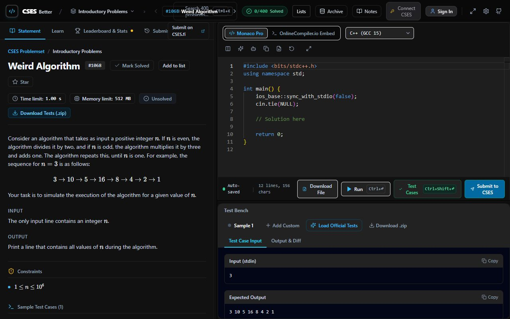

# CSES Better

A browser workbench for CSES: statements, code, tests, and official submissions in one place.

[Try it](https://cses-better.vercel.app) · [Practice](https://cses-better.vercel.app/practice) · [Contribute](CONTRIBUTING.md)




## Features

- Monaco editor, selected-input execution, and loaded-test execution.
- Personal CSES connection, official submissions, and available judge results.
- Learn explanations, problem lists, stars, notes, and verified solve streaks.
- Optional AI links with control over including editor code.
- Guest practice and optional app sign-in for supported cloud synchronization.

Workbench results cover loaded inputs; official acceptance comes from CSES. External services determine compiler and official-account availability.

## Run locally

Use Node.js 22 and npm:

```sh
npm ci
cp .env.example .env.local
npm run dev
```

Open http://localhost:3000 or http://localhost:3000/practice.

Configure your own compiler credentials for execution. The embedded compiler may require its own widget key. Supabase enables cloud features; without it, use guest mode. Enable GitHub OAuth and allow your deployment's /auth/callback URL. Optional server CSES credentials enable shared-session features; personal CSES connection is separate from app sign-in.

Never commit .env.local. Rotate any previously committed working bot credentials before publicity. See [SECURITY.md](SECURITY.md).

## Checks and deployment

```sh
npx tsc --noEmit
npm test
npm run build
```

Pull-request CI runs these checks. Verify OAuth, compiler access, and official submissions separately with a maintainer-controlled account.

Set NEXT_PUBLIC_APP_URL to your deployment origin. Check the preview on phone, tablet, and laptop before promotion.

Guest work lives in your browser. Export a JSON backup through settings before clearing site data. Cloud synchronization applies to supported records; check each feature's status and retry failures. Keep backups for local-only work.

## Contributing

Read [CONTRIBUTING.md](CONTRIBUTING.md) before opening a pull request. Documentation, accessibility fixes, reproducible bugs, and language starters are useful starting points. See the [Code of Conduct](CODE_OF_CONDUCT.md) and [Accessibility](ACCESSIBILITY.md) guidance. For security reports, follow [SECURITY.md](SECURITY.md). Issue reports must exclude passwords, tokens, private code, and account data.

## License and attribution

Application code is [MIT licensed](LICENSE). CSES statements, test data, and trademarks belong to their respective owners; the code license does not grant rights to upstream content. This is an independent project, not affiliated with CSES.

### Problem lists and Learn

Lists are saved locally and included in JSON backups. Signing in imports guest lists once and synchronizes account lists separately. Changes remain available offline; use Retry sync in Lists if a sync fails. When two devices edit the same list, the cloud version is kept and the local version is saved as a recovered list. Deleted lists use tombstones so an older device cannot restore them accidentally. Learn lessons are bundled static files; hints and explanations are revealed on demand.

Deploy `supabase/migrations/20261104172357_user_problem_lists.sql` to the linked Supabase project using `supabase db push` before enabling cloud list sync. The migration grants authenticated users access only to their own rows and enforces revision increments. Existing local lists continue to work if the migration has not been deployed.

### AI help, official submissions, and streaks

Use **Ask AI** in either problem workspace to open a hint-first prompt in Grok, or copy it and open ChatGPT, Claude, or Gemini. **Open Claude Desktop** is an optional link for the installed desktop app. Editor code is included only when selected. Grok may ask you to confirm before sending. If clipboard access fails, the menu provides selectable prompt text.

Submission filters query CSES history. Leaderboard **See code** retrieves actual accepted source; incomplete searches are labeled as the fastest result found. Official verdicts and available test details appear separately from local workbench runs. An interrupted verdict check can be retried without submitting code again.

Stars are stored per app account, with offline additions and removals retried during synchronization. The streak indicator counts verified personal CSES accepts, using the earliest retrieved acceptance per problem and a persisted timezone. Use **Import / continue history** to backfill older solves; **Pause import** saves progress. Coverage gaps remain visible until verified history is available. Shared-account submissions and manual solved marks do not add streak activity.

Before enabling cloud streak synchronization, deploy `supabase/migrations/20261106190911_official_solve_streaks.sql` to the linked Supabase project with `supabase db push`. It adds owner-restricted solve history and timezone preferences, preserves the earliest acceptance during concurrent updates, and ensures bookmark table access. Local storage remains available while cloud synchronization is unavailable. JSON backups include stars and streak history.
# Appearance and keyboard shortcuts

Use **Settings → Appearance** to choose Dark, Dim, Light, or System appearance and one of five accent colors. Changes apply immediately and are saved in this browser. The OnlineCompiler embed has its own theme controls.

Open **Settings → Shortcuts** to search commands, record a new key combination, disable a shortcut, or reset one binding. Browser-reserved combinations and conflicts are rejected with feedback. **Reset all shortcuts** restores the built-in defaults.
